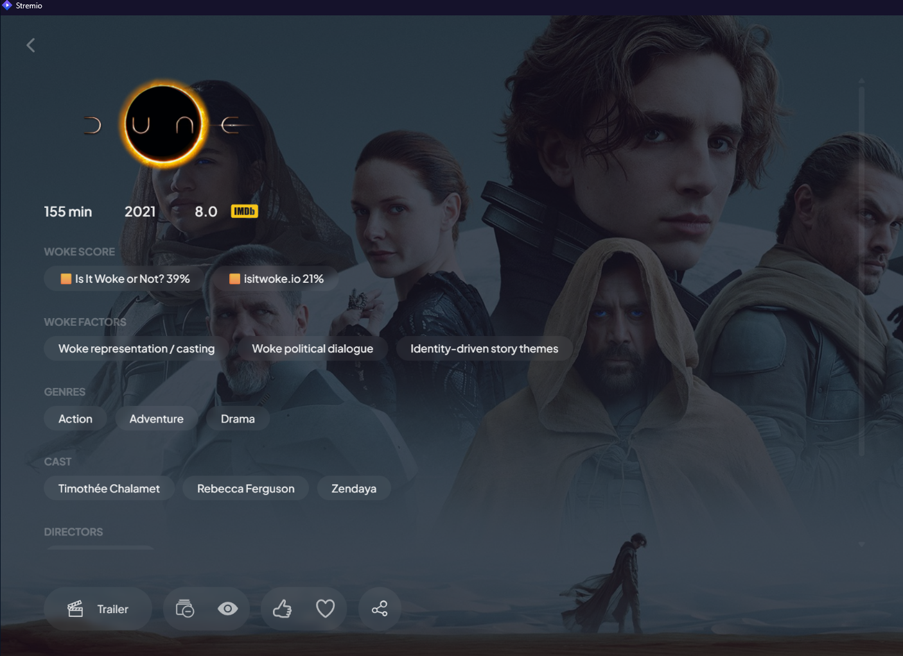
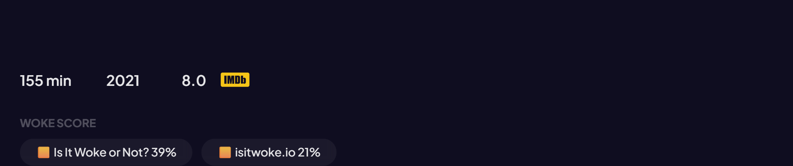
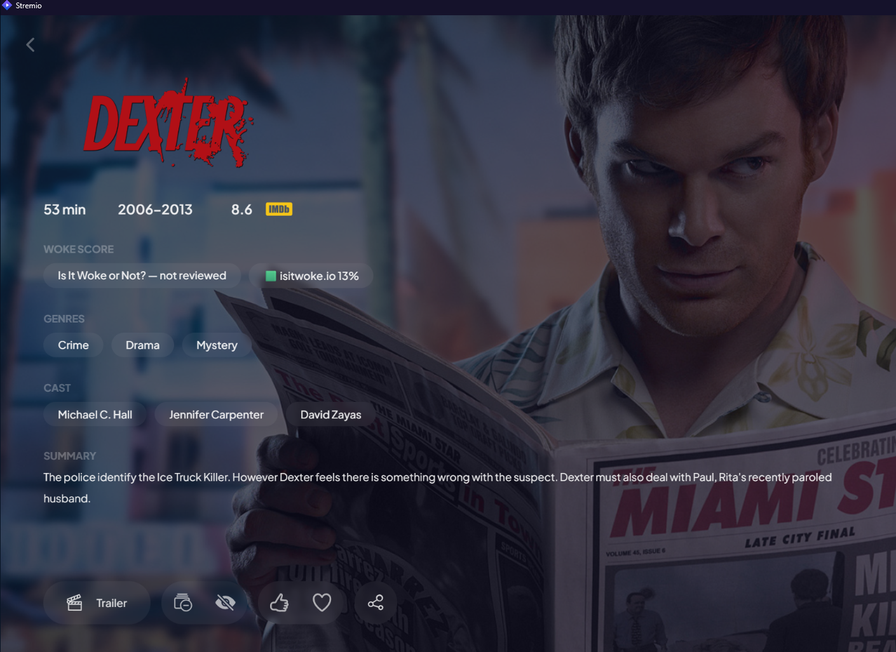
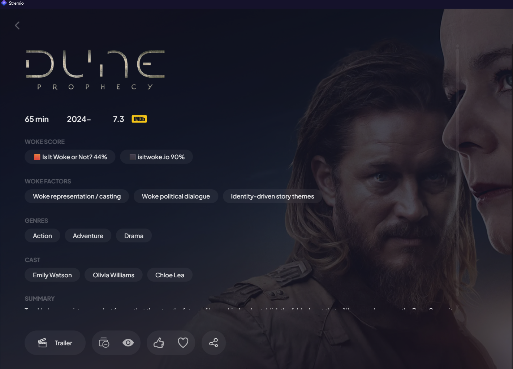
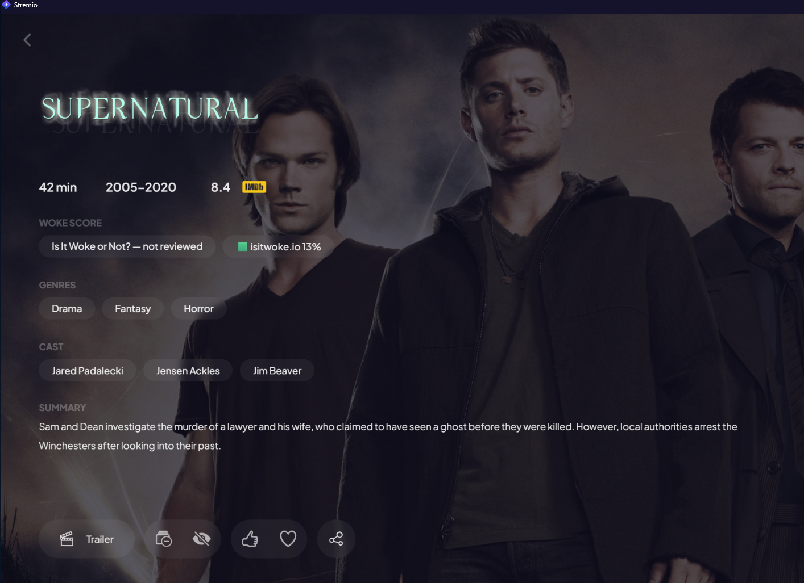

# Is It Woke? — Stremio addon

Woke scores on the movie and series page in Stremio: **one row**, two independent sources, sitting right
under the rating and above Genres. Every title is looked up **once** and then served from SQLite, so
neither site is ever queried twice for the same title.



*The score row sits between the rating and Genres, with the biggest scoring factors underneath it.*

## The two sources

| Source | What it is | Looked up by |
|---|---|---|
| [isitwokeornot.com](https://isitwokeornot.com) | hand-written editorial score 0-100, titles from 2016 onward | title name + year, verified against the title's own IMDb link |
| [isitwoke.io](https://isitwoke.io) | AI analysis with a verdict label, from *Absolute Cinema* up to *Certified Woke Trash* | TMDB id, which Cinemeta already gives us |
| [wokeometer.app](https://wokeometer.app) | AI score, published 0-10 (normalised to 0-100 here) | TMDB id, matched inside their search results |
| [wokealyzer.com](https://wokealyzer.com) | AI score, published 0-10 (normalised to 0-100 here) | IMDb id, matched exactly inside their search results |

Every source is keyless and every match is verified against an id rather than a guess. The two 0-10
sites are scaled x10 so all four share one aggregate. Any source can be switched off in the addon URL
(`srcIiwon`, `srcIio`, `srcWokeometer`, `srcWokealyzer`).

They cover different catalogues, so a title can show one number, both, or nothing at all for a source
that hasn't rated it (unrated sources simply drop out of the row rather than showing an empty entry).



Series work the same way, and the two sites often read a title very differently:

| | |
|---|---|
|  |  |
| *Dexter (2005) is outside the 2016-onward range of one site: not reviewed, 13% on the other.* | *Dune: Prophecy reads 44% on one site and 90% on the other.* |



## Install

1. In Stremio, open **Addons** → **Add addon**.
2. Paste this URL:

```
https://scrut.greekai.gr/woke/eyJ2IjoyfQ/manifest.json
```

3. Click **Install**, then restart Stremio.

**It must sit above Cinemeta** in your addon list. Stremio renders whichever metadata addon answers
first, so if Cinemeta wins you get its page and no score row. Drag *Woke Score* to the top of the list on
the Addons page, or set the order through the Stremio API (see below).

Every option is carried in the addon URL, so you can bake your own with the `/configure` page of whatever
instance you use.

## How it works

- Cinemeta's own metadata is fetched and decorated, so the poster, background, cast and episode list are
  untouched and the IMDb badge is left alone. The addon also mirrors and proxies Cinemeta's catalogs, so
  the board rows and search keep working.
- Stremio renders every `meta.links` entry whose category is not `imdb`, `share` or `Writers` as a titled
  row of chips — the same component as Genres and Cast. That is where the score row comes from; addons
  cannot inject custom HTML or images into Stremio.
- Both lookups run in parallel under a 4.5s deadline. If they are slow the untouched page is served and
  the lookup keeps running in the background to warm the cache.
- **SQLite caching**, `data/woke.db`: one row per (title, source), keyed by IMDb id. A title that has been
  resolved is answered from disk with zero upstream requests — for you and for anyone else who opens it.
  Titles the sites do not cover are stored as *missing* too, so they are never re-queried. Only genuine
  timeouts or errors stay uncached, so those retry later.
- **Metacritic-style Overall chip**: the mean of the sources that have a score, with the gap in brackets
  when they disagree — `⭐ Overall 30% (±18)` means 30% average, 18 points apart. It is hidden when only
  one source covers the title (an average would just repeat that number), and it is N-source ready, so a
  third source slots in without changes.
- No API keys anywhere: isitwokeornot.com's public endpoints are key-less and isitwoke.io's verdict is
  read out of its own page payload.
- Optional browse catalogs (least / most woke) come from an index built by `tools/prime_index.js`.

## Mobile and TV

Stremio's Android and TV builds draw their own detail screen and do **not** render the `meta.links`
chip row, so there the score is served as the first line of the description instead:

```
Woke: 🟧 Overall 40% (±49) · 🟨 Is It Woke or Not? 39% · 🟨 isitwoke.io 21% · 🟨 Wokeometer 30% · 🟥 Wokealyzer 70%

Paul Atreides arrives on Arrakis after his father accepts the stewardship…
```

The synopsis underneath is untouched — the line is prepended, never merged into it. Same five-step colour
scale as the chips (🟩 ≤19, 🟨 20-39, 🟧 40-59, 🟥 60-79, ⬛ 80-100); the Overall marker is the band of the
average. `description=false` (or `'auto'` for mobile-UA-only) and `markers=none` switch it off in the addon
URL. On mobile the score also appears in the **sources list** and in the **Discover rows**, which both work
regardless of addon order.

## Run your own

Node 18 or newer, zero dependencies.

```bash
PORT=7090 DATA_DIR=./data node src/server.js
```

| Variable | Default | Meaning |
|---|---|---|
| `PORT` | `7090` | listen port |
| `HOST` | `0.0.0.0` | bind address |
| `DATA_DIR` | `./data` | `woke.db`, `cache.json`, `index.json` live here |
| `BASE_PATH` | *(empty)* | optional path prefix, e.g. `/woke` behind a tunnel |
| `LOOKUP_DEADLINE_MS` | `4500` | how long to wait for the two sites before serving Cinemeta untouched |

Routes: `/manifest.json`, `/<config>/manifest.json`, `/<config>/meta/<type>/<id>.json`,
`/<config>/stream/...`, `/<config>/catalog/...`, `/configure`, `/health`.

Configuration lives in the addon URL as base64url JSON (`/<config>/manifest.json`) — open `/configure` to
pick the options and copy a ready-to-paste URL. Systemd unit, Cloudflare tunnel path rule, the crawler and
the ordering gotcha are documented in [docs/DEPLOYMENT.md](docs/DEPLOYMENT.md).

## Tests

```bash
node test/e2e.js      # boots the server on a random port and requests it the way Stremio does
node test/smoke.js    # per-title upstream check, prints every chip row
```

`test/e2e.js` asserts both source rows appear, that every chip has a URL and no colon in its label, that
Cinemeta's poster/background/episode list survive, and that a malformed config is rejected.

## Write-up

The story behind it, with the same screenshots:
**[Woke Score: see a movie's woke score inside Stremio](https://georgesaoulidis.com/woke-score-stremio-addon/)**

## Notes

- isitwoke.io has no API and no name search; its pages are TMDB-id keyed, so a title without a
  `moviedb_id` in Cinemeta simply gets no row from it.
- isitwokeornot.com ignores unknown query parameters on its free endpoints (`imdb_id=…` is only honoured by
  its paid API), hence the name + year match — every match is verified against the candidate's own
  `imdbUrl` before it is trusted.
- Series show series-level scores, not per-episode.
- Scores are the two sites' own editorial and AI judgements, not objective facts; on both, a lower number
  means less woke. This addon is not affiliated with either site or with Stremio.

MIT licensed.
